# DevOps, Homework 2 (Docker): звіт

Звіт по обов'язковій частині домашнього завдання з лекції 2 (Containerization).
У корені репозиторію лежить застосунок для **Task 8** (multi-stage build). Скріншоти до Tasks 4–7 лежать у `screenshots/`.

## Посилання

| Що | Посилання |
|---|---|
| GitHub (цей репозиторій) | https://github.com/vovaspk/devops-multistage-app |
| Образ у Docker Hub (Task 8) | https://hub.docker.com/r/kousei2413/multistage-app |
| Профіль Docker Hub | https://hub.docker.com/repositories/kousei2413 |

```bash
docker pull kousei2413/multistage-app:1.0
docker run --rm -p 8080:8080 kousei2413/multistage-app:1.0
```

## Зміст

| Task | Що зроблено | Де дивитись |
|---|---|---|
| 1–3 | Самонавчання (слайди, Get Started, best practices) | нічого здавати не треба |
| 4 | Запуск sample-app у контейнері | [Task 4](#task-4--запуск-sample-app-у-контейнері) |
| 5 | Інший файл даних: bind mount + ENTRYPOINT + CMD | [Task 5](#task-5--bind-mount--entrypoint--cmd) |
| 6 | 2 контейнери на спільному volume | [Task 6](#task-6--спільний-volume-для-двох-контейнерів) |
| 7 | 2 контейнери в одній мережі | [Task 7](#task-7--комунікація-між-контейнерами-в-одній-мережі) |
| 8 | Multi-stage build, GitHub + Docker Hub | [Task 8](#task-8--multi-stage-build) |

---

## Task 4: запуск sample-app у контейнері

Застосунок: [sample-app](https://github.com/elisska/devops-helpers/tree/main/sample-app) з репозиторію лекторки (Dash-візуалізація залежностей між об'єктами, порт 8050).

```bash
docker build -t sample-app:1.0 .
docker run -d --name sample-app -p 8050:8050 sample-app:1.0
docker ps
docker logs sample-app
docker exec sample-app whoami      # webservice, а не root
```

Збірка:
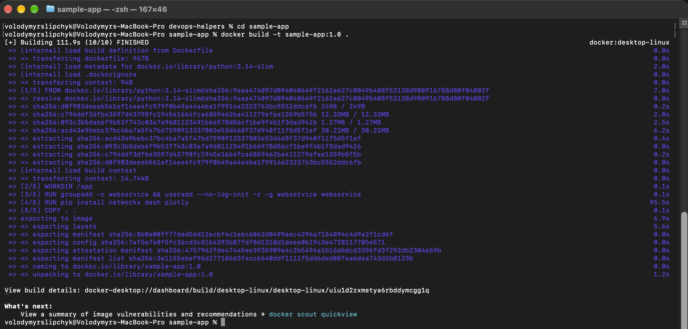

Запуск і `docker ps`:
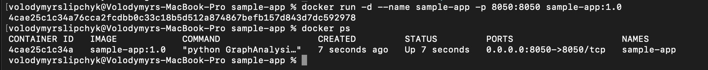

Логи контейнера:
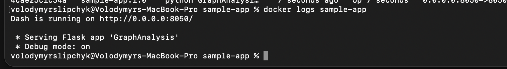

Процес працює від непривілейованого користувача `webservice`:
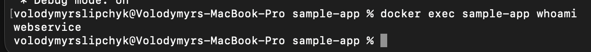

Результат у браузері на http://localhost:8050 (стандартні дані):
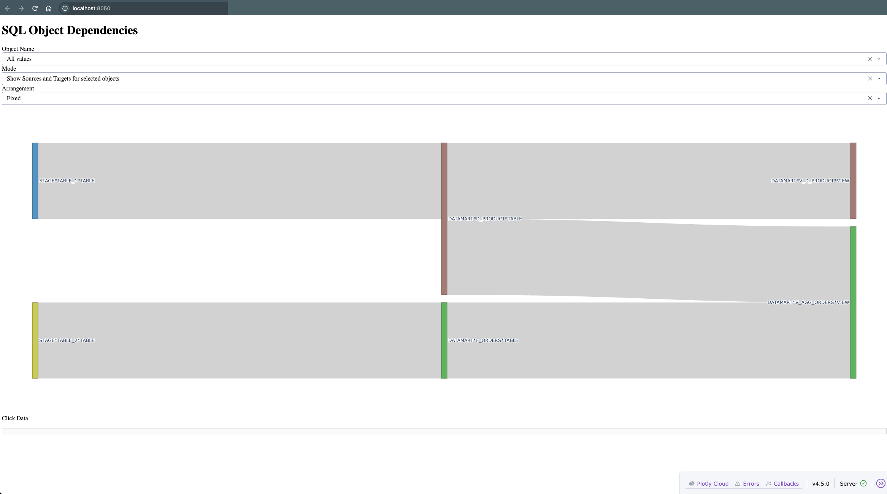

---

## Task 5: bind mount + ENTRYPOINT + CMD

Мета: візуалізувати **інший** файл даних, не перебудовуючи образ.

- Власний файл даних [task5/my_data.csv](task5/my_data.csv) лежить на хості (`~/hw-data/`), а не в образі.
- Образ збирається з [task5/Dockerfile-entrypoint-local](task5/Dockerfile-entrypoint-local): `ENTRYPOINT ["python", "GraphAnalysis.py"]` фіксує, **що** запускати, а `CMD ["obj_dependency_data.csv"]` задає аргумент **за замовчуванням**.
- При `docker run` CMD замінюється шляхом до файлу з bind mount, а ENTRYPOINT лишається.

```bash
docker build -f Dockerfile-entrypoint-local -t sample-app:entrypoint .
docker inspect -f 'ENTRYPOINT={{.Config.Entrypoint}} CMD={{.Config.Cmd}}' sample-app:entrypoint
docker run -d --name sample-app-data -p 8050:8050 \
  -v ~/hw-data:/data:ro \
  sample-app:entrypoint /data/my_data.csv
docker inspect -f '{{json .Mounts}}' sample-app-data      # "Type":"bind"
```

> **Примітка про `FROM`.** Готовий `Dockerfile-entrypoint` із репозиторію лекторки базується на її образі
> `elisska/devops-helpers:dockerfile-method`. У ньому дропдаун за замовчуванням жорстко прив'язаний до
> `value=[153, 154]` (ID об'єктів великого датасету), тому на маленькому файлі граф порожній.
> Я змінив у `GraphAnalysis.py` дефолт на `["all_values"]`, а `Dockerfile-entrypoint-local` базується
> на моєму локальному образі `sample-app:1.0` з цим виправленням.

Термінал: білд, ENTRYPOINT/CMD, `docker run` з bind mount, `ps`, `logs`, `Mounts`:
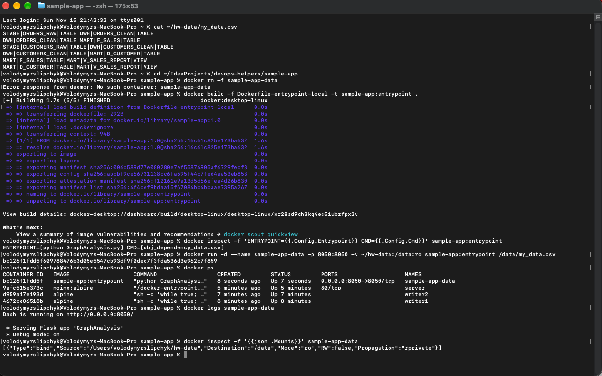

Граф з моїми даними (`STAGE → DWH → MART → V_SALES_REPORT`):
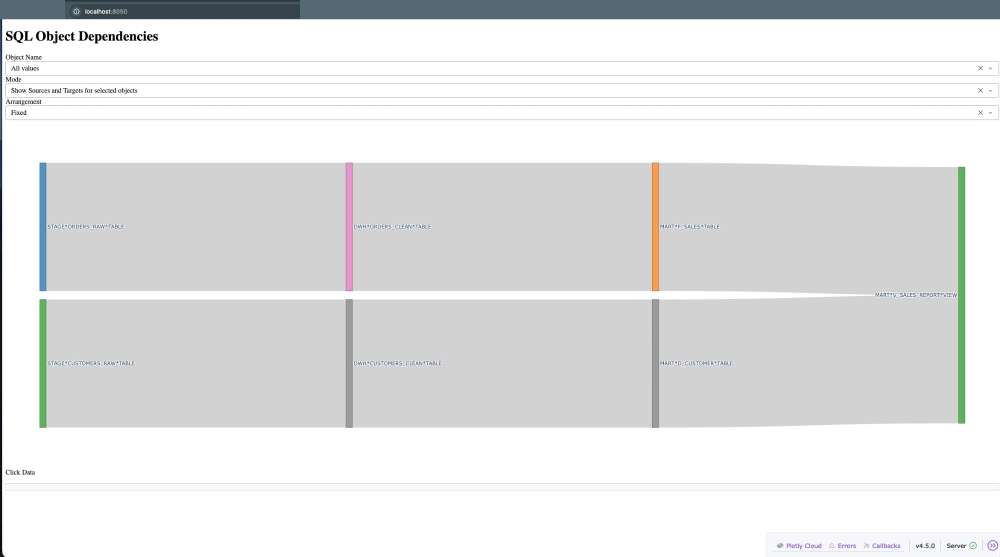

---

## Task 6: спільний volume для двох контейнерів

Два контейнери монтують один named volume `shared-vol` у `/data` і обидва пишуть у `/data/shared.log`.
Кожен контейнер бачить рядки іншого: це і є доказ спільних даних.

```bash
docker volume create shared-vol
docker run -d --name writer1 -v shared-vol:/data alpine \
  sh -c 'while true; do echo "writer1 $(date +%T)" >> /data/shared.log; sleep 2; done'
docker run -d --name writer2 -v shared-vol:/data alpine \
  sh -c 'while true; do echo "writer2 $(date +%T)" >> /data/shared.log; sleep 3; done'
docker exec writer1 tail -n 8 /data/shared.log
docker exec writer2 tail -n 8 /data/shared.log
docker volume inspect shared-vol
```

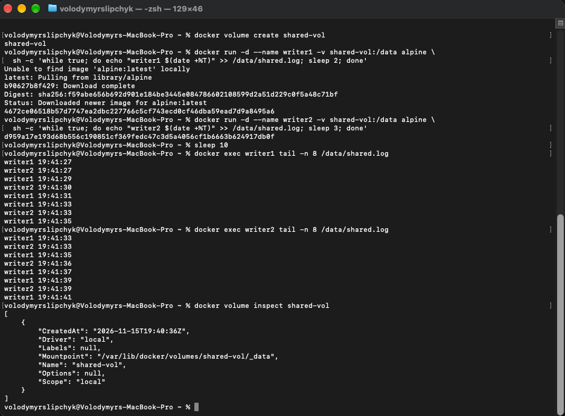

---

## Task 7: комунікація між контейнерами в одній мережі

Контейнери в одній користувацькій bridge-мережі знаходять один одного за **іменем** (вбудований DNS Docker).

```bash
docker network create hw-net
docker run -d --name server --network hw-net nginx:alpine
docker run --rm --network hw-net alpine sh -c 'ping -c 3 server && wget -qO- http://server | head -5'
docker network inspect hw-net
```

`ping server` проходить, `wget` повертає сторінку nginx, `network inspect` показує контейнер `server` у мережі:
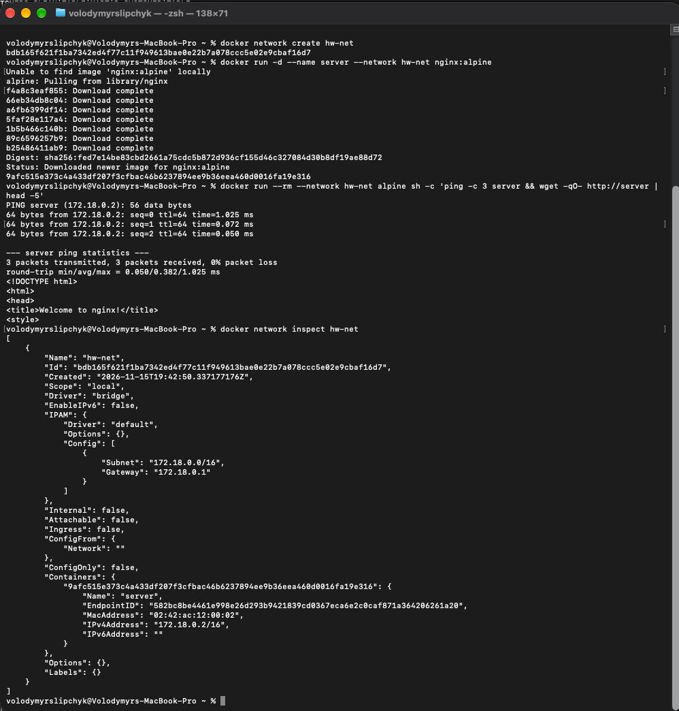

Контрольна перевірка: без спільної мережі ім'я `server` не резолвиться (`bad address 'server'`):
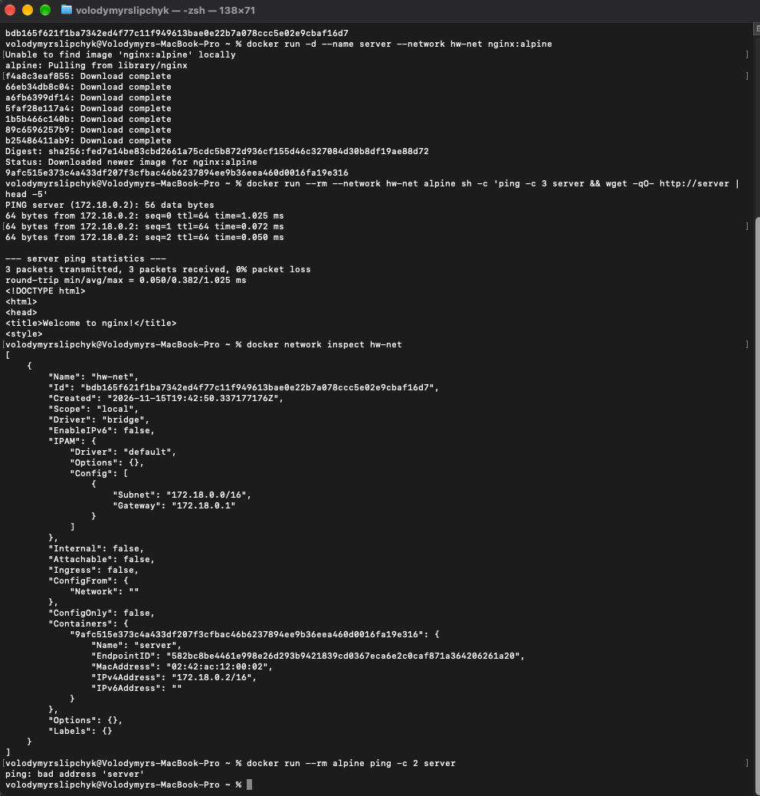

---

## Task 8: multi-stage build

Застосунок: невеликий Go HTTP-сервер ([main.go](main.go)) на порту 8080 (`/` та `/health`).

| Dockerfile | Що в фінальному образі | Розмір на диску |
|---|---|---|
| [Dockerfile.single-stage](Dockerfile.single-stage) | компілятор Go + код + бінарник | 471 MB |
| [Dockerfile](Dockerfile) (multi-stage) | лише скомпільований бінарник на Alpine | 24.9 MB |

**Як це працює.** У [Dockerfile](Dockerfile) два `FROM`. Stage 1 (`golang:1.23-alpine AS build`) компілює `main.go`.
Stage 2 (`alpine:3.20`) починає новий образ з нуля й бере тільки бінарник: `COPY --from=build /out/app /app`.
Фінальний образ складається лише з шарів останнього `FROM`, тому компілятор і вихідний код у нього не потрапляють.
Використано best practices: конкретні теги, `.dockerignore`, непривілейований користувач, порядок шарів для кешу.

```bash
docker build -t multistage-app:single -f Dockerfile.single-stage .
docker build -t multistage-app:multi .
docker images multistage-app
docker run -d --name multistage-app -p 8080:8080 multistage-app:multi
curl localhost:8080
docker exec multistage-app whoami
docker tag multistage-app:multi kousei2413/multistage-app:1.0
docker push kousei2413/multistage-app:1.0
```

Збірка без multi-stage (для порівняння):
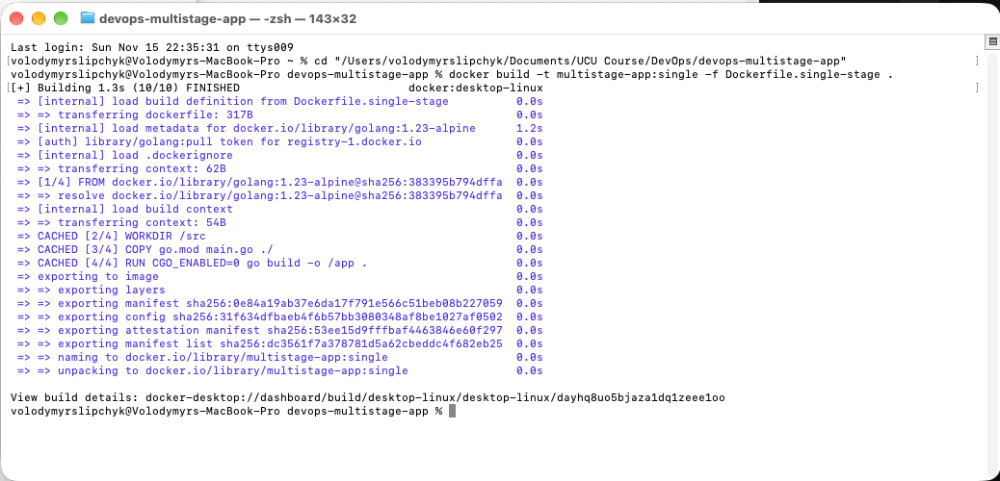

Multi-stage збірка (видно `[build ...]` і `[stage-1 ...]`):
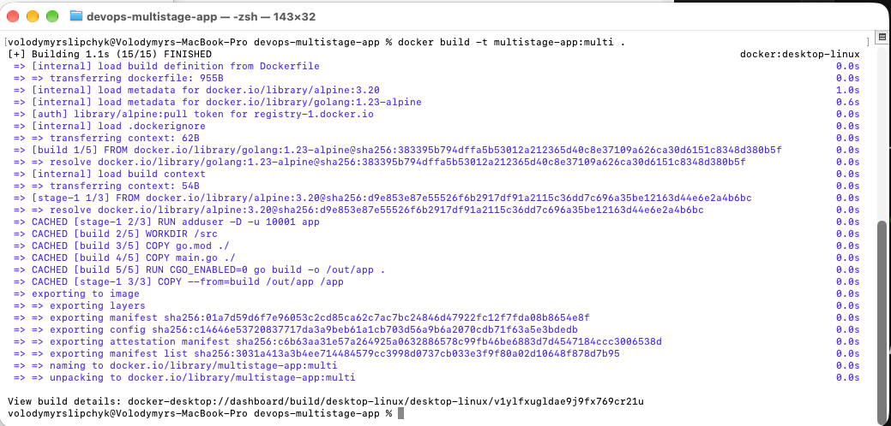

Порівняння розмірів, запуск і `curl`:
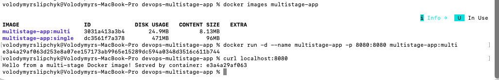

Відповідь у браузері на http://localhost:8080:
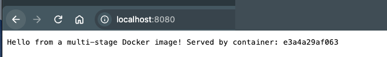

Контейнер працює не від root (`app`):
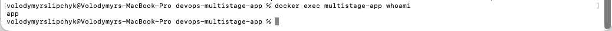

Публікація образу в Docker Hub:
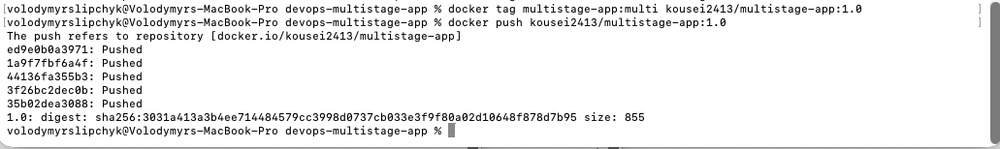

Образ у Docker Hub (публічний):
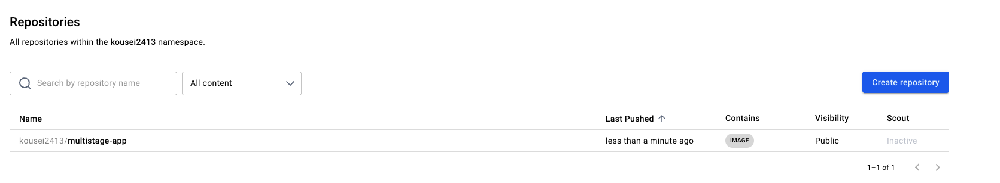
